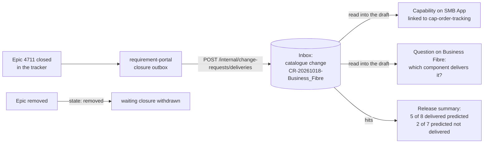

# Ontology plan, Phase 7 — What a closed Epic delivered

## Objective

Close the loop between the prediction and the delivery. When the Epic a requirement was
published as is closed in the work-item tracker, requirement-portal sends what it delivered:
the Features closed as done, the systems they changed, the systems the decided product impact
had predicted, and the catalogue changes that impact implies. It lands in the change-request
inbox as a **catalogue change**, read into a draft as suggestions like any other. Counted per
release, closures say how often the predicted systems were the ones delivered.

Phase 7 of the ontology and impact plan
([plan](https://claude.ai/code/artifact/27b1b1d1-b01b-40d4-9264-1999bc29b2bf)).
requirement-portal's side (the tracker's service hook and the closure outbox) is its own pull
request, after this release.

## User Outcome

- **Knowledge admin, Versions.** The inbox shows "Static IP quota for Business Fibre", with
  "Epic 4711 closed on 18 Oct 2026" linking to the tracker, the two delivered Features, the
  one that was removed, "Suggests: SMB App realises Order tracking; Business Fibre offers
  Order tracking" and "Delivered 2 of the 3 systems predicted (DCRM was not), and 1 not
  predicted (SMB App)". Reading it into the draft gives two suggestions.
- **Knowledge admin, the draft.** "Adds the capability Order tracking, realising the concept
  cap-order-tracking" on SMB App, and "Asks of Business Fibre: Which component of Business
  Fibre now delivers Order tracking?". Nothing reaches the catalogue until it is accepted.
- **Knowledge admin, front page.** For the edition in force, "Delivered systems predicted:
  5 of 8" and "Predicted systems not delivered: 2 of 7" beside the override rate, and a
  sentence in the edition's note.
- **Requirement work.** It sends each closed or removed Epic to
  `POST /internal/change-requests/deliveries`.

## In Scope

- The internal route, kept once per delivery id; a removal withdraws a waiting closure, and a
  later closure of the same Epic replaces one still waiting.
- Reading a catalogue change: a capability linked to its concept on each delivered system,
  and a question on the offering.
- A capability suggestion may carry one concept link (and applying any capability suggestion
  now keeps the link and "no concept fits" reason the capability had).
- The hit rate: per catalogue change, and per release on `GET
  /architecture-knowledge/deliveries/summary` (knowledge admins).
- The inbox and the front page.

## Out of Scope

- Reading the tracker: requirement-portal does, on its service hook.
- New-offering drafts from a delivery (Phase 9).
- Writing anything back to the tracker: this portal stays read-only to it.

## Domain



`IncomingChangeRequest` gains a `kind` (`approved_backlog` or `catalogue_change`) and, on a
catalogue change, a `DeliveryTrace`: the delivery and Epic ids, when it closed, the release
and decision (`ANA-1@7`) the product impact was assessed with, the verdicts, the offering,
the predicted systems, the Features not delivered and the `DeliveredChange`s.

| Change | Comes from | Read as |
|---|---|---|
| `realise_concept` | a needed concept the assessment found uncovered, and a delivered system on its path | a capability on that system, id from the concept (`cap:static-ip` → `static-ip`), named and matched by its labels, linked to it |
| `offer_concept` | the same concept, when the verdict names an offering | an open question on the offering: which component now delivers it |

`hits()` compares the delivered systems (the delivered Features' systems, by id, case set
aside) with the predicted ones: delivered and predicted, delivered but not predicted, and
predicted but not delivered. `delivery_summaries` counts each Epic once, by its latest
closure, leaves out dismissed ones, and groups them by release.

An example body, as requirement-portal sends it:

```json
{
  "delivery_id": "REQ-42:4711:evt-1",
  "state": "closed",
  "requirement_id": "REQ-42",
  "breakdown_revision": 2,
  "approval_id": "APR-9",
  "epic": {"id": "EP-1", "name": "Static IP quota", "external_id": "4711",
           "url": "https://dev.azure.com/acme/smb/_workitems/edit/4711"},
  "occurred_at": "2026-10-20T15:30:00+00:00",
  "release_id": "smb-source-reference-v1",
  "impact_version": "ANA-1@7",
  "decision": "accepted",
  "suggested_verdict": "change_existing_offering",
  "verdict": "change_existing_offering",
  "offering_id": "offering:business-fiber",
  "offering_name": "Business Fiber",
  "predicted_systems": [{"id": "bcrm", "name": "BCRM", "role": "primary", "change_type": "modify"},
                        {"id": "cim", "name": "CIM", "role": "supporting", "change_type": "configure"}],
  "features": [
    {"id": "FT-1", "sequence": 1, "name": "Order a static IP", "external_id": "4712",
     "state": "Closed", "delivered": true, "systems": [{"id": "bcrm", "name": "BCRM"}]},
    {"id": "FT-2", "sequence": 2, "name": "Show the IP on the bill", "external_id": "4713",
     "state": "Removed", "delivered": false, "systems": [{"id": "cim", "name": "CIM"}]}
  ],
  "changes": [{"op": "realise_concept", "concept_id": "cap:static-ip",
               "concept_label": "Static IP", "system_id": "bcrm", "system_name": "BCRM",
               "feature_ids": ["FT-1"]}]
}
```

Its hits: BCRM delivered and predicted, CIM predicted and not delivered.

## Application

- `ReceiveDelivery.closed` keeps a closure once, as `delivery:<delivery id>`, named
  `CR-<closed day>-<offering>`; a new closure withdraws the same Epic's waiting one ("A later
  closure of its Epic replaced it."). `ReceiveDelivery.removed` withdraws the Epic's waiting
  closures and returns their ids; one already read or dismissed is left alone.
- `read_change_request` reads a catalogue change with `read_delivery`. Warnings: a release
  other than the one in service, the Features not delivered, and a system, concept or
  offering the draft does not have; a suggestion already in the draft is left out.
- `ReadDeliverySummaries` (knowledge admins) gives the per-release counts.

## API

| Route | Who | Answer |
|---|---|---|
| `POST /internal/change-requests/deliveries` | requirement work's service token | 201 kept; 200 kept before, or a removal (`withdrawn`); 409 the same delivery id with another body; 422 a closure without a delivered Feature or a decided product impact, or a change from a Feature not delivered |
| `GET /architecture-knowledge/deliveries/summary` | `knowledge_admin` | per release: closures, delivered, predicted, unpredicted, undelivered, last closure |
| `GET /architecture-knowledge/change-requests` | `knowledge_admin` | each item now has `kind` and `delivery` (with `hits`) |

The internal contract (`contracts/knowledge-internal.openapi.json`) gains the route,
`DeliveryRequest` and `DeliveryReceipt`. Stored inbox rows need no migration: the new fields
have defaults.

## UI

- Versions, the inbox: a closure's row says "Epic closed: 2 delivered Features for Business
  Fibre", links the Epic in the tracker, lists the delivered Features, those not delivered,
  what it suggests, and the hit in one sentence. Reading it says "2 suggestions".
- The draft's suggestions: a capability that realises a concept says so.
- The front page: two totals in the architecture table, after the verdict counts, and a
  sentence in the edition's note. A rate appears from ten systems up, as with overrides.

## Business Rules

- A closure needs at least one delivered Feature and the decided product impact; requirement
  work sends nothing for an Epic it did not publish.
- A suggestion never relinks a capability that already has a concept, and linking one clears
  its "no concept fits" reason.
- A dismissed closure is not counted: a person said it was not a delivery.

## Tests

- `tests/unit/test_delivered_changes.py`: the domain's checks, hits and summaries; the
  capability's concept link (new, already realised, needs the concept, keeps an existing link
  or reason); reading a closure and what it could not match; receiving, replacing and
  withdrawing; the routes, their refusals and the summary's access.
- `tests/integration/test_postgres_change_requests.py`: a catalogue change round-trips and is
  withdrawn.
- `tests/unit/test_knowledge_internal_contract.py`: the new seam.
- `frontend/src/catalogue/changeRequests.test.tsx` and `frontend/src/home/derive.test.ts`.

## Acceptance Criteria

- [x] A closed Epic reaches the inbox once, with what it delivered and what was predicted.
- [x] Reading it suggests the capabilities delivered, linked to their concepts, and asks the
  offering which component delivers them.
- [x] A removed Epic withdraws its waiting closure.
- [x] The front page shows the delivery hit rate beside the override rate.

## Validation Evidence

Run on 2026-10-11 against this branch:

- `pytest` with PostgreSQL 16 and pgvector: 1152 passed
- `ruff check .`, `ruff format --check .`, `mypy src tests`, `lint-imports`: pass
- frontend `typecheck`, `lint`, `vitest` (295 passed), `build`, `api:check`: pass
- The impeccable critique of the inbox (desktop and phone) and the front page against a live
  seeded page with three closures: the hit and "predicted but not changed" lines merged into
  one sentence, "not changed" became "not delivered" to match the table, and the no-change
  line was reworded.

## For review

- The capability id comes from the concept id. If a system already has a capability with that
  id for something else, accepting merges the labels into it; the reviewer sees "updates".
- A closure for a release no longer in service is still read, with a warning.
