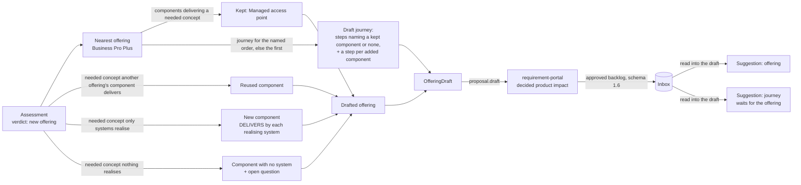

# Ontology plan, Phase 9 — New-offering drafts

## Objective

When a requirement is a new offering, say what the catalogue would hold for it. For a
`new_offering_in_family` or `new_product_line` verdict, the assessment drafts an offering
and the journey that fulfils it, from the nearest offering, by fixed rules: no model is
involved, so the same requirement against the same release always gives the same draft.
requirement-portal keeps the draft on the decided product impact and sends it back with the
approved backlog, where reading the backlog into a draft release suggests the offering and
the journey for a curator to edit and accept.

Phase 9 of the ontology and impact plan
([plan](https://claude.ai/code/artifact/27b1b1d1-b01b-40d4-9264-1999bc29b2bf)).
requirement-portal's side (keeping, showing and sending the draft, export schema 1.6) is its
own pull request, after this release.

## User Outcome

- **Requirement work.** An assessment of "A lighter bundle with a managed access point,
  without SD-WAN or the firewall" says it is a new offering in the family of Business Pro
  Plus, and its proposal carries a drafted offering, "A lighter bundle with a managed access
  point, without SD-WAN or the firewall", with Business Pro Plus's access point (FortiAP)
  and its New activation journey. "Cloud video surveillance for shops" drafts a new line whose
  one component no system realises yet, with the question "Which system will realise Cloud
  video surveillance?".
- **Knowledge admin, Versions.** The inbox row of that requirement's approved backlog says
  "Drafts the offering … from Business Pro Plus: Access point (FortiAP), by ECM, WFMS, CWOM."
  and
  "Its journey, New activation, has 27 steps." Reading it suggests the offering and the
  journey first, then the features' questions.
- **Knowledge admin, the draft.** The two suggestions come "from the decided product impact";
  each is reviewed alone (never in "accept all"), and the journey waits for its offering.
  Accepting records "Adds the offering …, drafted for the requirement" in the version's change
  history, with the change request as the offering's source.

## In Scope

- The draft builder (`domain/architecture/offering_drafts.py`) and the draft itself
  (`domain/architecture/drafts.py`).
- `AssessmentProposal.draft` on `POST /internal/architecture/assess`, for the two new-offering
  verdicts.
- `product_impact.draft` on the approved-backlog export (schema 1.6 on), kept on the inbox item
  and read into two suggestions.
- The inbox's two sentences, and the suggestion's source line.
- The golden-set check: every draft applies cleanly.

## Out of Scope

- A model writing the proposition, rules or plans: the draft holds only what the catalogue
  already says; a curator writes the rest.
- Drafts for a change, a new plan, or a delivery (Phase 7 suggests capabilities instead).
- requirement-portal's storing, showing and sending (its own pull request).

## Domain



The rules, in order:

| Step | Rule |
|---|---|
| Name and id | The requirement's title (its first line), cut at a word to 80 characters; the id is its slug, cut at a word to 48 characters. Neither takes an existing offering's: "Business Pro Plus (2)", `business-pro-plus-2`. |
| Placement | In a family: the nearest offering's family and portfolio node. A new line: neither, for a curator to place. Lifecycle "Proposed"; confidence inferred; source "Drafted for requirement REQ-…". |
| Order types | The nearest offering's, as they are. |
| Kept components | The nearest offering's components that deliver a needed concept, with their responsibilities. |
| Each other needed concept, in the order the requirement names them | Reuse a component of another offering that delivers it, kept to the draft's order types; else a new component named after the concept, with a `DELIVERS` responsibility for each system that realises it (its own capability first); else a component with no system (confidence gap) and an open question for architecture review. |
| Journey | The nearest offering's journey for the order the requirement names, else its first. Its steps that name a kept component, or none; its flow rules and integrations between kept steps; then one step per added component, numbered on in tens, performed by its first system and supported by the rest. Without a nearest offering, a "Fulfilment" journey of the added steps. |

`draft_problems(release, draft)` says why the draft would not apply to a release as a new
offering and a new journey, the offering first; the evaluation and the tests use it.

An example draft, as the assessment answers with it (empty fields left out):

```json
{
  "offering": {
    "id": "cloud-video-surveillance-for-shops-with-cameras",
    "name": "Cloud video surveillance for shops, with cameras installed on site",
    "lifecycle": "Proposed",
    "confidence": "inferred",
    "source": "Drafted for requirement REQ-2026-0517",
    "components": [
      {"id": "cloud-video-surveillance", "name": "Cloud video surveillance",
       "description": "Delivers Cloud video surveillance.", "confidence": "gap",
       "capability_ids": ["cap-video-surveillance"],
       "source": "Drafted for requirement REQ-2026-0517"}
    ],
    "questions": [
      {"id": "realise-cloud-video-surveillance",
       "text": "Which system will realise Cloud video surveillance?",
       "impact": "No system in the release realises it, so architecture review decides before the offering can be delivered.",
       "confidence": "gap", "source": "Drafted for requirement REQ-2026-0517"}
    ]
  },
  "journey": {
    "id": "cloud-video-surveillance-for-shops-with-cameras-journey",
    "name": "Fulfilment",
    "product_id": "cloud-video-surveillance-for-shops-with-cameras",
    "confidence": "inferred",
    "activities": [
      {"number": "10", "name": "Cloud video surveillance", "track": "MAIN",
       "component_ids": ["cloud-video-surveillance"], "confidence": "gap",
       "description": "No system realises Cloud video surveillance yet; see the offering's open question."}
    ]
  },
  "based_on": null
}
```

For the lighter bundle, `based_on` is `business-pro-plus`, the family "Business internet
bundles" and the node `business-internet` are kept, the one component is `ap`, and the
journey is New activation's 27 steps, none of which names a component.

## Application

- `AssessRequirement._proposal` drafts for the two new-offering verdicts, from the nearest
  offering (the offering in question), in the coverage order of the needed concepts, for the
  order type the requirement names.
- `ReceiveChangeRequest` keeps the draft on the inbox item; `read_change_request` reads it
  first: an offering or journey already in the draft as it is now is left out, with a
  warning; one that would replace another (the same name or id) is suggested with a warning
  to rename it.
- `needs_one_by_one` keeps a drafted offering or journey out of "accept all".
- `accept_from_change_request` records "Adds the offering …, drafted for the requirement" (or
  the journey) and registers the change request as the offering's source.
- The evaluation scores, with `drafts_applied`, the share of drafts that apply cleanly, and
  says how many of the cases labelled a new offering were drafted for.

## API

| Route | Who | Change |
|---|---|---|
| `POST /internal/architecture/assess` | requirement work's service token | `proposal.draft`: `{offering, journey, based_on}` in the catalogue's own shapes, for a new-offering verdict |
| `POST /internal/change-requests` | requirement work's service token | optional `product_impact: {verdict, offering_id, release_id, draft}` (export schema 1.6); a draft that breaks the catalogue's rules is a 422 naming `product_impact.draft` |
| `GET /architecture-knowledge/change-requests` | `knowledge_admin` | each item has `draft`: the offering, its components and their systems, its questions, and the journey's name and step count |

Both contracts change additively. Stored inbox rows need no migration: the new field has a
default.

## UI

- Versions, the inbox: an approved backlog with a draft adds three sentences under its
  features (the offering, its components with their systems, its journey and open
  questions), naming systems and the nearest offering as the catalogue names them. Reading
  it says "3 suggestions".
- The draft's suggestions: a drafted offering or journey says it comes from "the decided
  product impact", not from a feature, carries no feature's reading notes, and needs a
  person's decision ("Drafted for a new offering: review what it holds") once it no longer
  waits for anything.

## Business Rules

- A draft never reaches the catalogue by itself: each suggestion is accepted alone.
- A draft is checked as any catalogue edit is when it arrives: a broken one is refused.
- Only an approved backlog carries a draft.

## Tests

- `tests/unit/test_requirement_assessment.py`: a family draft from the nearest offering, a
  new line's gap and question, no draft for a change or a plan, a reused component and one per
  realising system with unique names and ids, the drafted name, determinism, and that each
  draft applies.
- `tests/unit/test_change_requests.py`: the draft read first and reviewed alone, accepted
  with its history; one already present or clashing; only a backlog carries one; the assess
  answer round-trips as the export's draft; the route, its refusal and the inbox.
- `tests/integration/test_postgres_change_requests.py`: a draft round-trips.
- `tests/unit/test_mapping_evaluation.py`: every draft applies; a draft exactly for each
  new-offering verdict.
- `frontend/src/catalogue/changeRequests.test.tsx`: the inbox sentences and the reading's
  count; `frontend/src/catalogue/suggestions.test.ts`: a drafted offering is decided alone,
  its journey waits for it.

## Acceptance Criteria

- [x] A new-offering verdict carries a drafted offering and journey, the same each time.
- [x] The approved backlog carries it back, and reading it suggests both.
- [x] Every draft the golden set produces applies cleanly to the release.

## Validation Evidence

Run on 2026-10-11 against this branch:

- The evaluation with the fake models: drafts applied 100.0%; new offerings drafted 2 of 12
  (the fake reasoner calls the other ten a change, a plan or too vague: the verdict gate, not
  the draft). Every other score is unchanged.
- `pytest` with PostgreSQL 16 and pgvector: 1164 passed
- `ruff check .`, `ruff format --check .`, `mypy src tests`, `lint-imports`: pass
- frontend `typecheck`, `lint`, `vitest` (298 passed), `build`, `api:check`: pass
- The impeccable critique of the inbox and the draft's suggestions (desktop and phone)
  against a live seeded page with the two drafts above: the offering's name ran into the
  sentence, so it is quoted and the components and journey have a sentence each; the
  drafted offering's suggestion had no name and showed the first feature's reading notes,
  and the journey's wait named the offering by its id; a drafted offering counted as ready
  for "accept all" on the page though the service refuses it; the citation's nested quotes
  were dropped.

## For review

- A drafted offering copies all the nearest offering's order types, and its journey keeps
  every step that names no component, since most steps name none; the curator removes what
  the new offering does not need.
- Only the nearest offering's journey for one order type is drafted.
